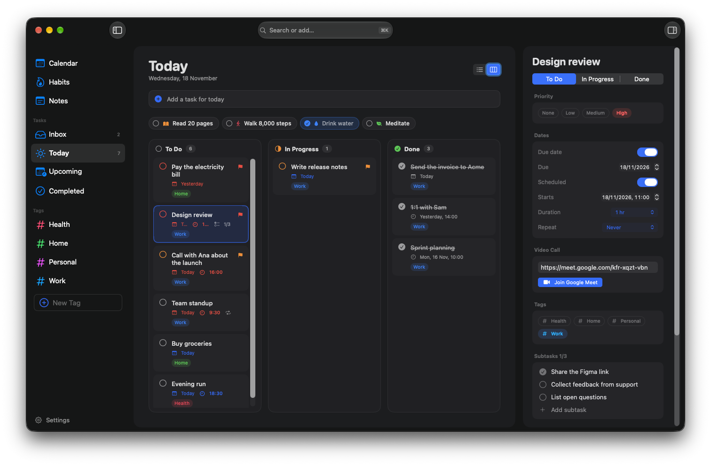
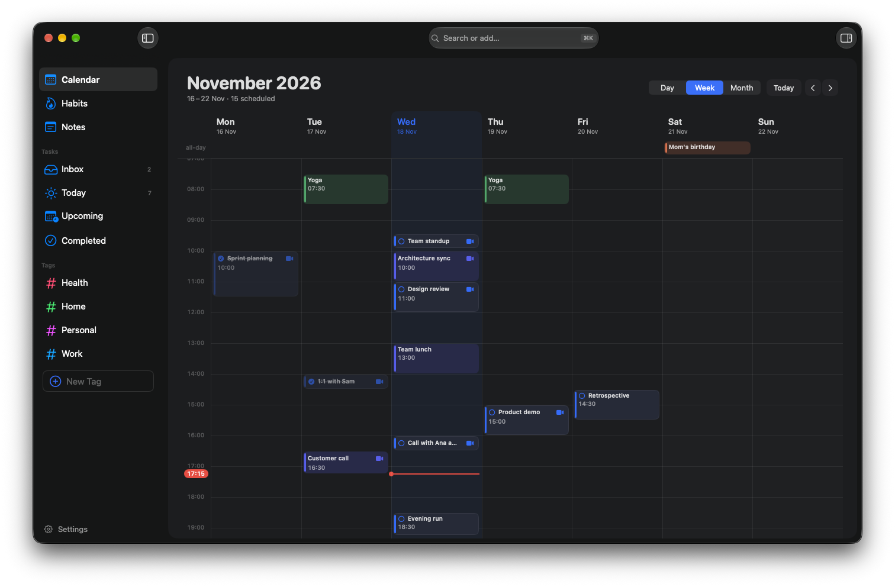
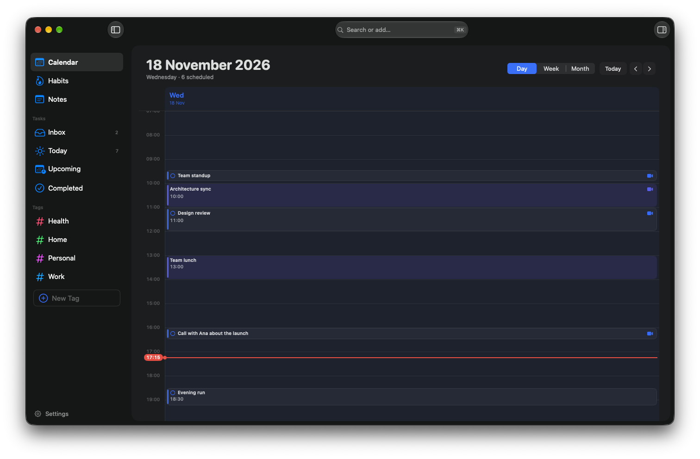
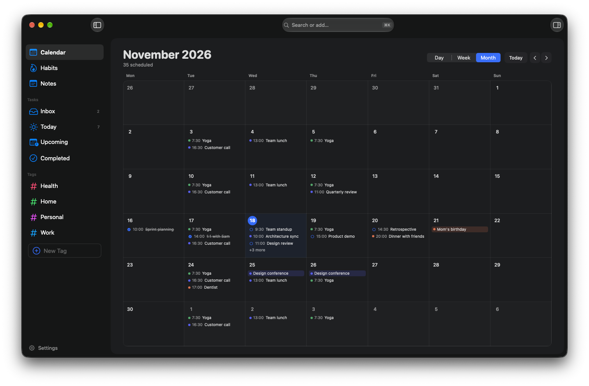
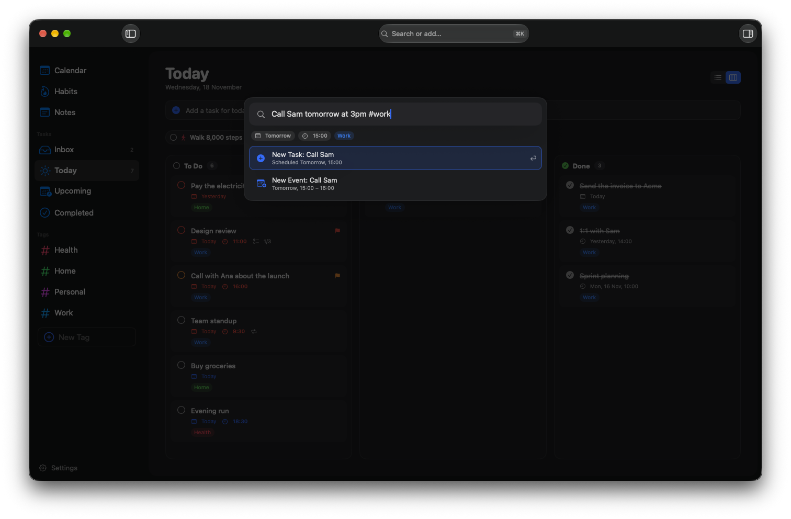
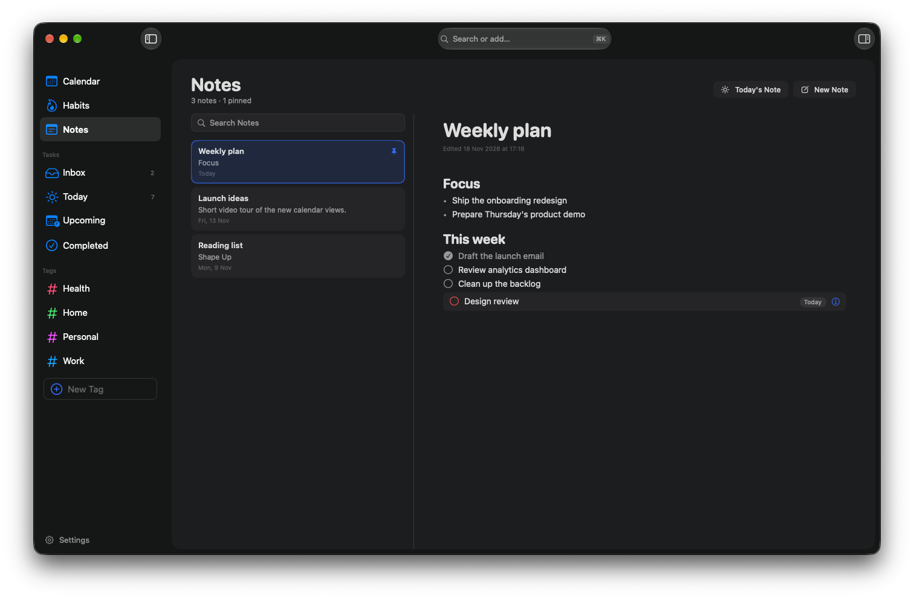
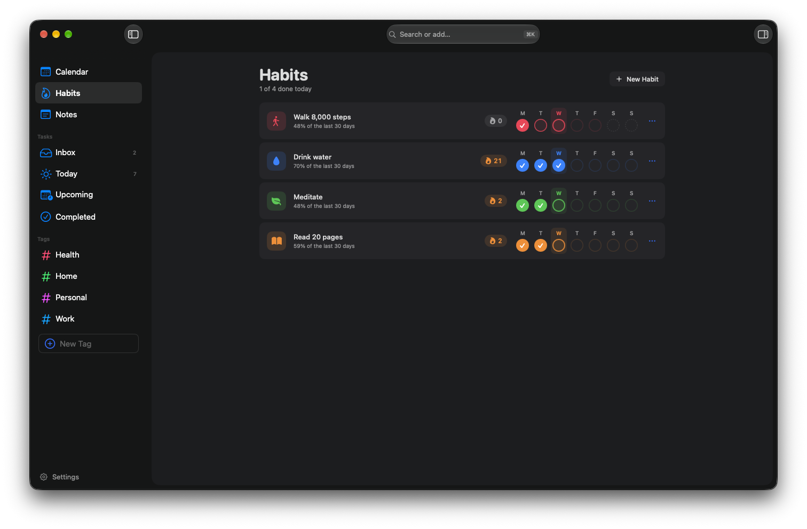

<h1> Dayloom</h1>

A native macOS planner that keeps your tasks, calendar, habits and notes in one window, synced across your Macs through iCloud.



## Install

With [Homebrew](https://brew.sh):

```sh
brew trust juancasanueva/tap
brew tap juancasanueva/tap
brew install --cask dayloom
```

Or download `Dayloom-<version>.zip` from the [latest release](https://github.com/juancasanueva/dayloom/releases/latest), unzip it and move `Dayloom.app` to Applications. Releases are signed with Developer ID and notarized by Apple.

## Features

- **Tasks**: Inbox, Today, Upcoming and Completed lists, tags, and a status board.
- **Calendar**: day, week and month views with your calendar events next to your scheduled tasks. Double-click or right-click an empty slot to create a task there.
- **Video calls**: give a task a meeting link and join it with one click. Dayloom recognizes Google Meet, Zoom, Teams and Webex links, opens Zoom and Teams meetings in their apps when installed, and offers Join on calendar events that mention a meeting. It can also create a Google Meet or Zoom meeting for a task, or open Teams to make one.
- **Reminders**: a notification before a task starts, or on the day it's due.
- **Quick Launcher**: capture tasks from anywhere with a global hotkey.
- **Habits**: daily habits with streaks, plus recurring tasks.
- **Notes**: block-based notes with headings, lists, checklists, linked tasks and calendar events, plus a daily note.
- **Appearance**: light, dark or system appearance, with a choice of color themes.
- **iCloud sync**: all data syncs through your private iCloud database. Settings (⌘,) shows the sync status.

## Screenshots

<table>
  <tr>
    <td width="50%"><br><sub><b>Week</b>: events and scheduled tasks side by side; video calls show a camera.</sub></td>
    <td width="50%"><br><sub><b>Day</b>: one day in detail, with the current time.</sub></td>
  </tr>
  <tr>
    <td width="50%"><br><sub><b>Month</b>: the whole month at a glance.</sub></td>
    <td width="50%"><br><sub><b>Quick Launcher</b>: type a sentence, get a dated, tagged task or event.</sub></td>
  </tr>
  <tr>
    <td width="50%"><br><sub><b>Notes</b>: headings, lists, checklists and linked tasks.</sub></td>
    <td width="50%"><br><sub><b>Habits</b>: weekly progress and streaks.</sub></td>
  </tr>
</table>

Screenshots use sample data: Debug builds launched with `-DayloomDemo` open an in-memory store with sample tasks, habits, notes and calendar events instead of your own.

## Keyboard shortcuts

| Action | Shortcut |
|--------|----------|
| New task | ⌘N |
| New note | ⇧⌘N |
| Quick Launcher (in app) | ⌘K |
| Quick Launcher (anywhere) | ⌃⌥Space |
| Show or hide the inspector | ⌥⌘I |
| Calendar, Inbox, Today, Upcoming, Completed, Habits, Notes | ⌘1 to ⌘7 |
| Previous or next day, week or month; back to today | ⌘←, ⌘→, ⌘T |

## Requirements

- macOS 15 (Sequoia) or later
- Xcode 27 to build

## Building

Open `agenda.xcodeproj` in Xcode and run the `agenda` scheme. The project and its folders keep their original `agenda` name; the app itself is called Dayloom.

iCloud sync needs a build signed with a team that has the iCloud container `iCloud.com.juancasanueva.agenda`. Without that entitlement the app still runs and keeps your data on this Mac only.

### Creating meetings

Creating meetings signs in to Google or Zoom from the app. Each service needs its own app registration; the client IDs are public identifiers, not secrets, and live in code. Sign-ins are kept in the Mac's Keychain and never sync to iCloud. Settings → Video Calls shows each connection and can disconnect it.

- **Google Meet** (`GoogleOAuthConfig.app`): a Google Cloud project with the Google Meet REST API enabled, an OAuth client of type **iOS** for bundle ID `com.juancasanueva.agenda`, and the scope `https://www.googleapis.com/auth/meetings.space.created`. While the consent screen is in Testing, only accounts listed under Audience → Test users can sign in.
- **Zoom** (`ZoomOAuthConfig.app`): a user-managed General App in the Zoom App Marketplace with **Use Public Client OAuth** on, its **public client ID**, the scope `meeting:write:meeting`, and the PKCE redirect URL `http://127.0.0.1/callback` (registered without a port). Sign-in opens in the default browser and returns to a listener the app runs on `127.0.0.1:47823` only while signing in.
- **Teams**: Microsoft only lets apps create Teams meetings for work or school accounts, so New Teams Meeting opens Teams to make a link to paste.

### Releasing

`scripts/release.sh` archives the app, exports it with Developer ID, notarizes and staples it, and checks the zip the way a user receives it. It needs an App Store Connect API key (`ASC_KEY_PATH`, `ASC_KEY_ID`, `ASC_ISSUER_ID`), and the team's Account Holder signed in to Xcode, because only they can create the Developer ID provisioning profile that carries the iCloud container. Upload `build/Dayloom-<version>.zip` to a GitHub release tagged `v<version>`; the Homebrew tap picks up new releases on its own.

## Tests

```sh
xcodebuild test -project agenda.xcodeproj -scheme agenda -destination 'platform=macOS' -only-testing:agendaTests
```

## License

MIT. See [LICENSE.md](LICENSE.md).
